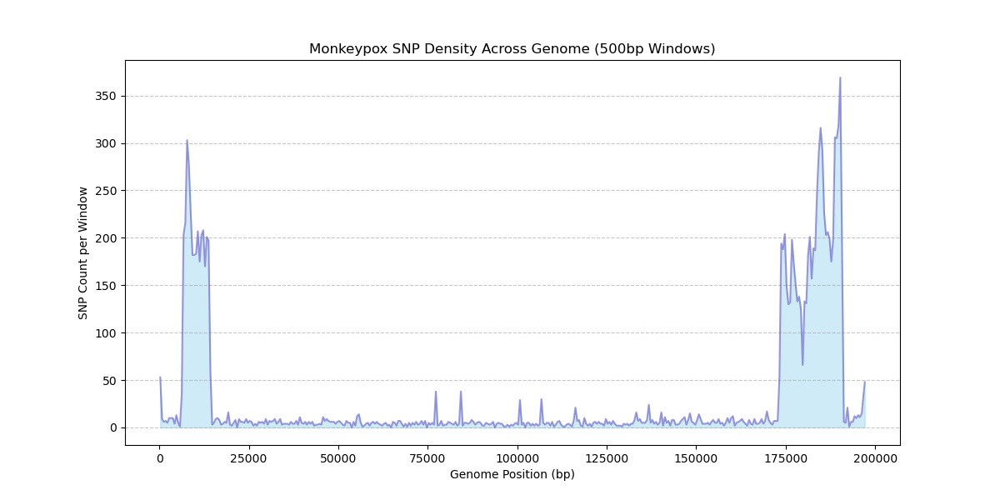
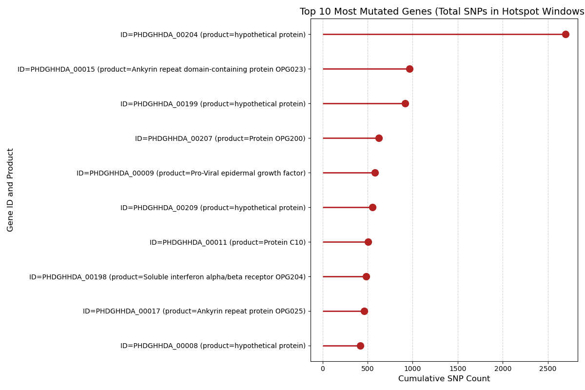
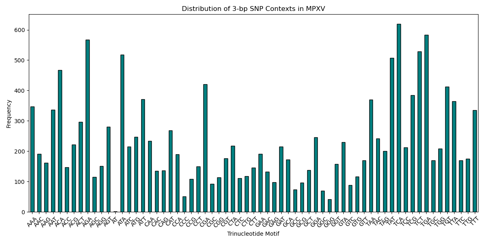
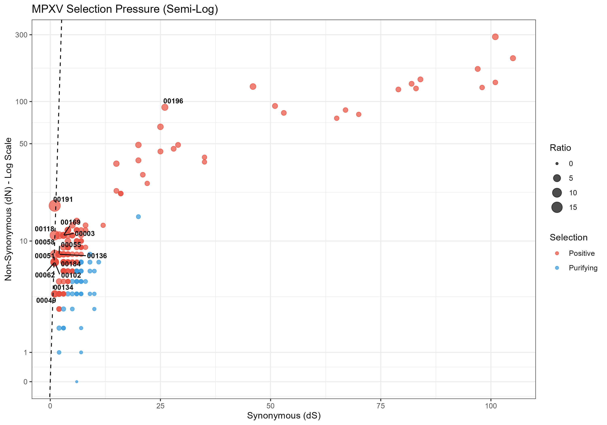
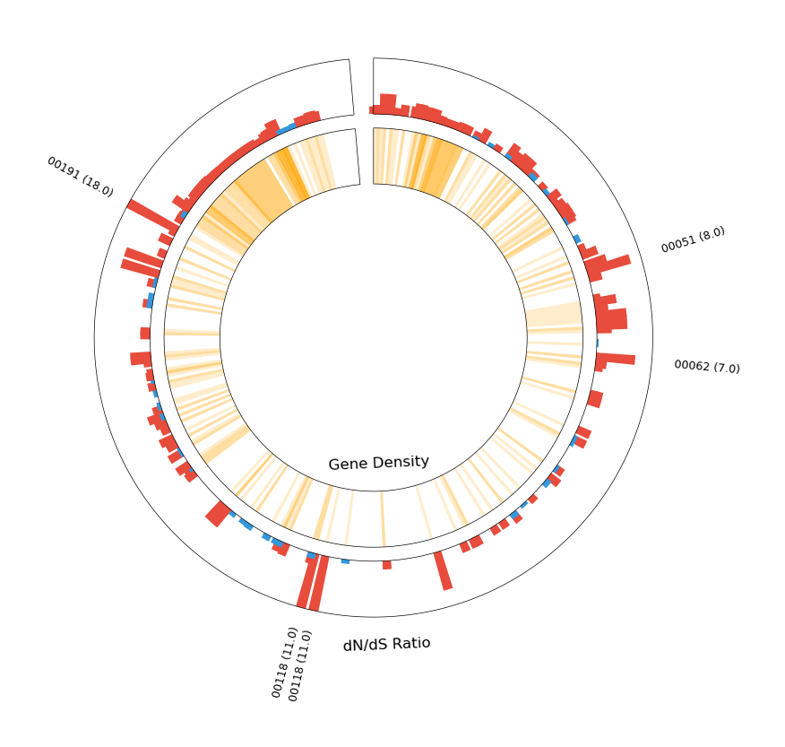

# Mpox Mutation Hotspots & Selection Pressure (`mpox-mutation-hotspots`)

> **Objective 1** of the B.Sc. (Life Sciences) 4th-Year Dissertation: *"Multi-Scale Genomic Architecture of Monkeypox Virus Human Adaptation: Mutation Hotspots, Structural Variants, and Ortholog Divergence in Sustained-Transmission Lineages"* (Department of Zoology, Deshbandhu College, University of Delhi, 2026).

## Overview

This repository documents the computational workflow and analytical outputs for mapping genome-wide single nucleotide polymorphism (SNP) hotspots—including analyses independent of APOBEC3/APOBEC3F signatures—alongside 3-bp trinucleotide context profiling and selection pressure (`dN/dS`) estimation across **1,236 high-quality Monkeypox virus (MPXV) genomes**.

## Dataset & Filtering Criteria

* **Source:** NCBI Virus (`https://www.ncbi.nlm.nih.gov/labs/virus/`), retrieved as of **02 January 2026**.
* **Cohort Size:** **1,236** complete MPXV genomes.
* **Quality Filters:**
  * Minimum sequence length: **170 kb**
  * Nucleotide completeness: **Complete**
  * Ambiguous characters: **None**
* **Reference Genome:** `NC_063383` (plus custom `.gbk` reference databases).
* **Metadata:** `.csv` compilation including Accession ID, collection date, country, geographic location, and manually added latitude/longitude coordinates.

## Methodology Pipeline

1. **FASTA Preparation & Annotation:**
   * Generate individual FASTA files per accession using Python.
   * Annotate all 1,236 genomes using **PROKKA** to extract `.faa` (predicted proteins), `.gbk` (annotated genomes), and `.gff` coordinate files.
   * Combine `.faa` files and collapse redundancy with **CD-HIT** to build a non-redundant (`nr`) protein set.
2. **Phylogeny & SNP Calling:**
   * Determine optimal k-mer size (`k = 19`) with `kchooser` and call SNPs (`.vcf`) / SNP-based Maximum Likelihood (ML) phylogeny using **kSNP4** (with Jellyfish k-mer partitioning), visualized in **Microreact** with geographic color-coding.
   * Align sequences via **MAFFT** and call variants using **SNP-sites** (Galaxy).
3. **3-bp Window Context & APOBEC3 Filtering:**
   * Convert `.vcf` to `.bed` via `bcftools` and `bedtools`.
   * Index reference sequences with `samtools` (`.fai`) to expand SNPs into **3-bp windows** and extract trinucleotide contexts.
   * Filter APOBEC3-compatible motifs (`TC -> TT` forward / `GA -> AA` reverse) to isolate non-APOBEC3 hotspots.
4. **Sliding Window Hotspot Analysis & Gene Mapping:**
   * Run **500 bp sliding window** analysis (`395` windows across the ~197 kb genome) using `bedtools`.
   * Classify windows with **SNP density > 0.01 SNPs/bp** as mutation hotspots (`257` hotspot windows identified).
   * Intersect hotspot coordinates with PROKKA `.gff` annotations using `bedtools intersect`.
5. **Selection Pressure (`dN/dS`) & Multi-Scale Visualization:**
   * Calculate synonymous (`dS`) and non-synonymous (`dN`) substitution ratios (`dN/dS`) in Python (`pandas`).
   * Generate SNP density plots, 3-bp trinucleotide motif charts, top mutated gene rankings, annotated Manhattan plots, R-based semi-log `dN/dS` selection plots, and `pycirclize` Circos plots.

## Key Findings & Results

* **Genome-Wide Hotspot Clustering:** Across 500 bp sliding windows, SNP counts remain low across the central genome and cluster strongly toward the terminal regions—with a left-side peak (~7,500–15,000 bp, ~300 SNPs/window) and a higher right-side peak (~175,000–190,500 bp, reaching ~369 SNPs/window), annotated at high-intensity peaks with `ID=PHDGHHDA_00208` and `ID=PHDGHHDA_00207`.
* **Top Mutated Genes in Hotspot Windows:** Cumulative hotspot SNPs are led by `PHDGHHDA_00204` (`hypothetical protein`, ~2,700 SNPs), followed by `PHDGHHDA_00015` (`Ankyrin repeat domain-containing protein OPG023`, ~1,000 SNPs), `PHDGHHDA_00199` (`hypothetical protein`, ~900 SNPs), `PHDGHHDA_00207` (`Protein OPG200`), `PHDGHHDA_00009` (`Pro-Viral epidermal growth factor`), `PHDGHHDA_00209` (`hypothetical protein`), `PHDGHHDA_00011` (`Protein C10`), `PHDGHHDA_00198` (`Soluble interferon alpha/beta receptor OPG204`), `PHDGHHDA_00017` (`Ankyrin repeat protein OPG025`), and `PHDGHHDA_00008` (`hypothetical protein`).
* **3-bp Trinucleotide Context Profile:** Motif frequencies are highest for AT-rich trinucleotides such as `TCA` (>600), `TGA` (~580), `AGA` (~565), `TCT` (~525), `ATA` (~515), and `TAT` (~505), while GC-heavy motifs such as `CCC` and `GGG` show much lower counts.
* **Selection Pressure (`dN/dS`) & Circular Architecture:** Semi-log `dN` vs. `dS` selection analysis and circular genome tracks (`dN/dS Ratio` and `Gene Density`) highlight elevated positive selection ratios across loci including `00191` (`18.0`), `00118` (`11.0`), `00051` (`8.0`), `00062` (`7.0`), and `00196`, alongside `00169`, `00003`, `00058`, `00055`, `00136`, `00184`, `00102`, `00134`, and `00049`.

### Visual Summary












## Repository Structure

```text
mpox-mutation-hotspots/
├── README.md
├── scripts/          # Bash, Python, and R scripts for preprocessing, filtering, hotspots, dN/dS, and plotting
└── results/          # Generated figures (Manhattan, circular, 3-bp context, SNP density, top genes, semi-log dN/dS)
